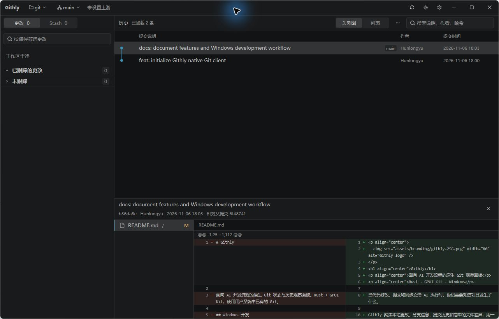
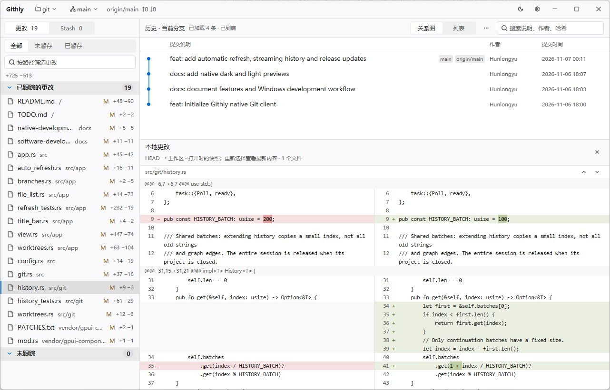

<div align="center">
  
  <h1>Githly</h1>
  <p><strong>A Native Desktop Git Companion for AI-Driven Development Workflows</strong></p>

  <p>
    <a href="https://github.com/Hunlongyu/githly/releases/latest"></a>
    <a href="https://github.com/Hunlongyu/githly/actions/workflows/windows.yml"></a>
    <a href="https://github.com/Hunlongyu/githly/releases"></a>
    
    
  </p>

  <p>
    <strong>English</strong> · <a href="README.zh-CN.md">简体中文</a>
  </p>

  <p>
    <a href="#highlights">Highlights</a> ·
    <a href="#preview">Preview</a> ·
    <a href="#download--installation">Download</a> ·
    <a href="#quick-start">Quick Start</a> ·
    <a href="#feature-guide">Feature Guide</a> ·
    <a href="#keyboard-shortcuts">Shortcuts</a> ·
    <a href="#build-from-source">Build</a>
  </p>
</div>

---

**Githly** is a fast, read-focused native desktop Git browser designed for modern AI-assisted coding workflows. When AI agents, CLI tools, or external editors modify files and create commits in the background, Githly automatically refreshes your local repository state—letting you inspect working tree changes, staged diffs, commit graphs, stashes, and worktrees in a single window without interrupting your tools.

## Preview



<details>
<summary><strong>View Light Theme</strong></summary>
<br />



</details>

## Highlights

- **Built for AI & CLI Workflows** — Automatically refreshes local status (~3s in the foreground, ~600s in the background) without locking your repository or interfering with ongoing Git operations.
- **Reading Position Preservation** — Open diffs keep their snapshot and scroll position while background changes happen. When browsing older history, Githly notifies you of new commits without jumping your viewport.
- **Side-by-Side Text & Image Diffs** — Inspect unstaged and staged modifications separately or together, jump between hunks, and preview before/after image changes (`PNG`, `JPEG`, `GIF`, `WebP`, `BMP`, `ICO`, `TIFF`, `SVG`).
- **Streaming Commit Graph** — Explore commit history with an interactive branch graph or flat list across the current branch, a specific branch, or all branches, streaming batches on demand as you scroll.
- **Stash & Worktree Inspector** — Browse saved stashes (including untracked files) and inspect or switch between active Git worktrees directly from the top bar.
- **Native Rust + GPUI Performance** — Uses your system Git asynchronously with strict memory budgets and viewport virtualization.

## Download & Installation

Install Git before opening a repository. Use Settings to choose its executable if it is not on PATH.

Githly uses the first supported language in your system preferences (English or Simplified Chinese), with English as the fallback. To override it, open **Settings → Language**, choose a language, and restart Githly.

Download the latest installer or portable archive from **[GitHub Releases](https://github.com/Hunlongyu/githly/releases/latest)**. Every release includes changelog notes and `SHA256SUMS.txt` for checksum verification.

| Edition | Artifact | How to Run |
| --- | --- | --- |
| **Windows x64 installer** | `*-windows-x64-setup.exe` | Run the installer for the current user, then launch **Githly** from the Start menu or desktop. |
| **Windows x64 portable ZIP** | `*-windows-x64.zip` | Extract the archive to any folder and run `Githly.exe`. |
| **macOS** | `*-macos-arm64.dmg` (Apple Silicon) or `*-macos-x64.dmg` (Intel) | Mount the DMG and drag Githly to Applications. The app is ad-hoc signed and has not been notarized by Apple. |
| **Ubuntu 24.04 amd64** | `*-linux-x64.deb` | Run `sudo apt install ./Githly-*-linux-x64.deb` in the download folder. Launch Githly from the app menu or run `githly /path/to/repository`. The desktop requires a Vulkan driver and X11 or Wayland. |
| **Linux x86_64 AppImage** (CI, then releases after v0.1.2) | `*-linux-x64.AppImage` | Run `chmod +x Githly-*-linux-x64.AppImage`, then launch the file. Built on Ubuntu 22.04. Requires system Git, a Vulkan driver and X11 or Wayland. |

Test packages from successful main-branch runs are available for 14 days to signed-in GitHub users. [Windows builds](https://github.com/Hunlongyu/githly/actions/workflows/windows.yml) · [macOS and Linux builds](https://github.com/Hunlongyu/githly/actions/workflows/desktop.yml)

## Quick Start

Githly runs a single window per user session. Launching it again focuses or restores the existing window, and passing a repository path as a CLI argument opens that project directly in the active window.

1. **Open a Repository** — Drag and drop a local Git folder into the window, press `Ctrl+O` to browse, or pick a project from **Recent Repositories**.
2. **Inspect Working Changes** — Switch between **All**, **Unstaged**, and **Staged** in the left **Changes** panel, and click any file to view its diff. Files with both staged and unstaged edits can be inspected separately.
3. **Explore Commit History** — Click any commit on the right to open its first changed file below. Switch files in the commit file list and use **Previous Change** / **Next Change** to jump across diff hunks.
4. **Browse & Switch Branches** — Click the branch selector in the top bar (`Ctrl+B`) to inspect the history of any local or remote-tracking branch. To check out a different local branch in your working directory, click **Switch** next to an existing local branch (requires a clean working tree with no active merge or rebase).

## Feature Guide

| What You Want to Know | How Githly Shows It |
| --- | --- |
| **How much has changed?** | The **Changes** panel groups tracked and untracked files, supports path filtering, and asynchronously computes per-file and total added/deleted line counts. |
| **How do branches diverge and merge?** | Toggle between the **Commit Graph** and **List** views across the current branch, a selected branch, or all branches. History loads ~2 screens initially and streams up to 100 commits per batch as you scroll near the bottom. Search filters loaded commits. |
| **How far ahead or behind is my branch?** | View ahead/behind commit counts relative to upstream. Remote-tracking branches and counts reflect local refs and update automatically after you run `git fetch` in your terminal or IDE. |
| **Did files change while I was reading?** | Githly checks local state about every 3 seconds in the foreground and every 10 minutes in the background. Refocusing triggers an immediate check if the last successful read was at least 3 seconds ago. When viewing older commits, a banner alerts you to new commits until you return to the top. Open diffs preserve your reading position; reselect a file to reload its latest contents. |
| **What exactly changed in a commit?** | Read the full commit message and side-by-side monospace text diffs with line numbers and change highlighting. Supported image formats are previewed side by side (`GIF` and `WebP` render their first frame). |
| **What is inside Stashes and Worktrees?** | The **Stash** view shows saved files and diffs, including untracked files captured in the stash. The top-bar **Worktree** menu lists paths, branches, and dirty states across linked worktrees and lets you open any worktree directly. |

> **Scope by Design:** Staging, committing, pushing, pulling, fetching, and conflict resolution are intentionally left to your Git CLI, IDE, or AI coding agent. Githly stays strictly read-only (aside from explicit clean-tree local branch switching) so it never conflicts with your workflow, and reflects changes on the next automatic refresh.

## Software Updates

Githly checks for updates at startup. When a newer version is available, a download icon appears in the upper-right corner. Click it to read the release notes, then choose **Download update** to see the progress bar. You can close the dialog and reopen it while the download continues.

Windows installations update through Setup and get a desktop shortcut. A portable copy downloads the ZIP and replaces its executable in the same folder. Restart it to use the new version. On macOS and Linux, Githly opens the verified platform package. If a direct download fails, Githly tries its built-in mirrors and verifies the bytes against the size and SHA-256 supplied by GitHub.

On macOS, use Command in place of Ctrl for Githly shortcuts.

## Keyboard Shortcuts

| Action | Shortcut |
| --- | --- |
| Open local repository | `Ctrl+O` |
| Search loaded commits | `Ctrl+F` |
| Open branch selector | `Ctrl+B` |
| Navigate focused commit or file list | `↑` / `↓`, `Home` / `End` |
| Open Settings / Close dialog or popover | `Ctrl+,` / `Esc` |

### Configuration & Logs

macOS stores settings and logs under `~/Library/Application Support/githly`. Linux uses the XDG config and data directories, usually `~/.config/githly` and `~/.local/share/githly`. On Windows:

- **Configuration:** `%APPDATA%\githly\config.json` (stores recent repositories, theme, panel dimensions, and custom Git path).
- **Application Logs:** `%LOCALAPPDATA%\githly\logs` (records warnings and operational errors for troubleshooting).

## Build from Source

### Prerequisites

- **Rust MSVC Toolchain** (pinned automatically via `rust-toolchain.toml`)
- **Visual Studio C++ Build Tools** & **Windows SDK**
- **CMake**

On macOS, install Xcode and its command-line tools. On Linux, use the packages listed in the [native build workflow](.github/workflows/desktop.yml). All platforms use the pinned Rust toolchain.

### Run & Test

```powershell
git clone https://github.com/Hunlongyu/githly.git
cd githly

# Build and launch Githly
cargo run --locked

# Or open a specific repository directly
cargo run --locked -- "E:\path\to\repository"
```

### Project Documentation

- **[Native Development Notes](docs/native-development.md)** — Architecture, memory boundaries, streaming history design, and verification benchmarks.
- **[Release & Update Guide](docs/releases.md)** — Packaging scripts, Inno Setup installer build, update manifest format, and mirror rules.
- **[Development Checklist (TODO)](TODO.md)** — Completed milestones and deferred items.
- **[Changelog](CHANGELOG.md)** — Version history and release notes.
