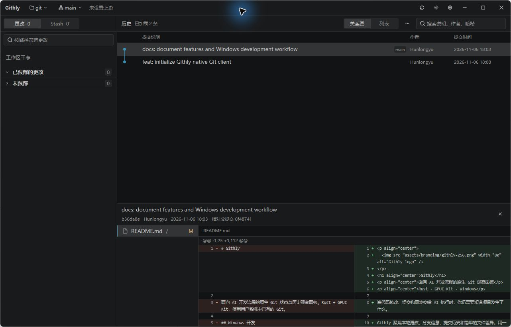

  
  <h1>Githly</h1>
  
本地 Git 仓库浏览器。编辑器、终端或 AI 助手改动仓库时，文件列表和提交历史会自动刷新。

  
<a href="https://github.com/Hunlongyu/githly/releases/latest"><strong>下载最新版</strong></a> · <a href="CHANGELOG.md">更新日志</a> · <a href="README.md">English</a>

[查看浅色主题](docs/screenshots/native-light.png)

## 安装

先安装 Git，再按系统选择安装包。

| 系统 | 安装方式 |
| --- | --- |
| Windows x64 | 运行 `-setup.exe` 安装包，或解压便携版 ZIP 后运行 `Githly.exe`。 |
| macOS | Apple Silicon 选 `arm64.dmg`，Intel 选 `x64.dmg`。打开后将 Githly 拖入「应用程序」。 |
| Ubuntu 24.04 x64 | 在下载目录运行 `sudo apt install ./Githly-*-linux-x64.deb`。 |
| Linux x64 便携版 | 运行 `chmod +x Githly-*-linux-x64.AppImage`，然后打开该文件。 |

Githly 启动时会检查更新，也可以随时在「设置 → 关于」中点击「检查更新」。发现新版后，可在关于页点击「查看新版」，或点击主窗口右上角的下载图标，查看更新说明并升级。

## 使用

将仓库目录拖进窗口，或按 `Ctrl+O` 打开。macOS 快捷键使用 `⌘` 代替 `Ctrl`。

- 在「更改」中选择文件，并排对比当前提交与工作区的文本或图片。文件状态分两位，左侧是暂存区，右侧是工作区。
- 点击提交查看改动，按 `Ctrl+F` 搜索已加载的提交，按 `Ctrl+B` 选择要浏览的分支。
- 在「储藏」中查看保存的更改，从顶栏「工作树」菜单打开其他工作目录。

## 从源码构建

克隆仓库后，在根目录运行 `cargo run --locked`。Windows 需要 Visual Studio C++ Build Tools、Windows SDK 和 CMake，macOS 需要 Xcode 和命令行工具。Linux 所需软件包见[构建工作流](.github/workflows/desktop.yml)。

[配置和日志](docs/native-development.md#配置和日志) · [开发文档](docs/native-development.md) · [打包与发布](docs/releases.md)
